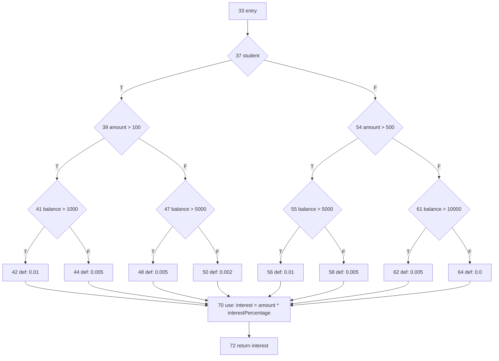
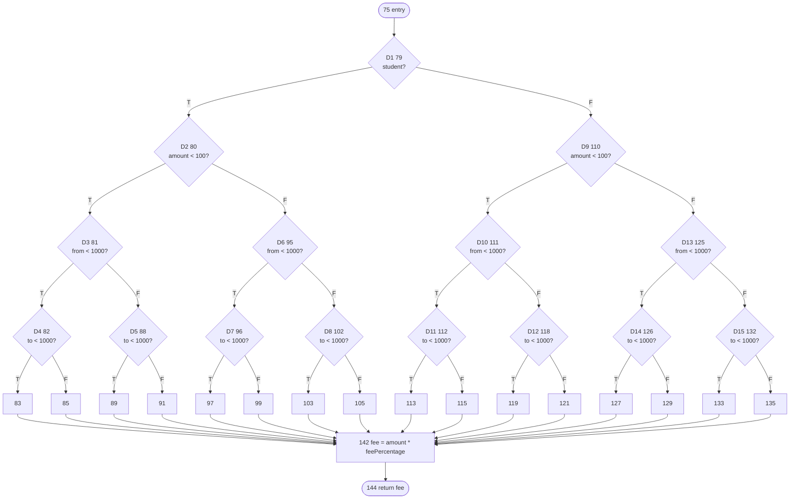
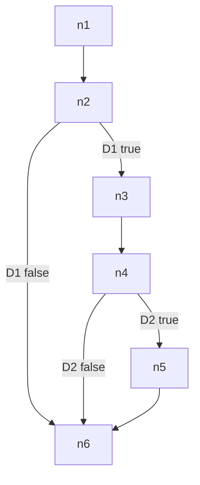
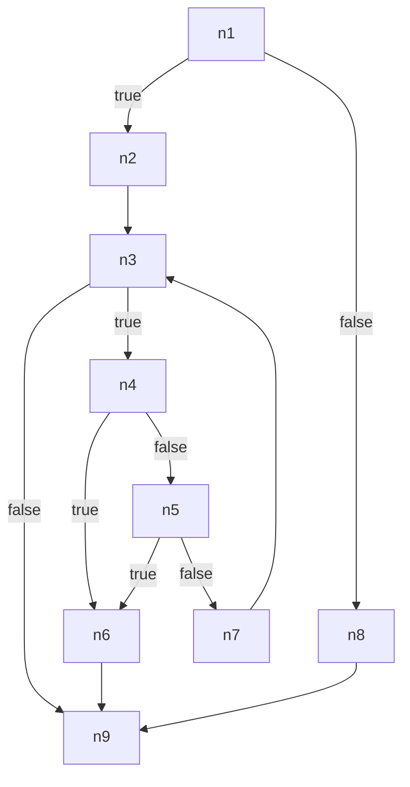

# Assignment 2: White-Box Testing and Fault Localization

Team: Alan Cruz, Jared Jack Harrison, Alessia Pilla, Julia Kasperek

| Target | Technique | Owner | Test class |
|---|---|---|---|
| `FeesCalculator.calculateWithdrawalFee` | Backward slice on FinalUse(fee), statement coverage of the slice | Alan Cruz | `src/test/java/bank/utils/FeesCalculatorWithdrawalTest.java` |
| `FeesCalculator.calculateDepositInterest` | DU-paths of `interestPercentage`, statement coverage of each DU-path | Jared Jack Harrison | `src/test/java/bank/utils/FeesCalculatorDepositTest.java` |
| `FeesCalculator.calculateTransferFee` | Basis path testing (control-flow graph, V(G), basis paths) | Julia Kasperek | `src/test/java/bank/utils/FeesCalculatorTransferTest.java` |
| Bonus: `CashValidator.validateWithdrawal`, `FormatChecker.checkPinFormat` | Basis path testing | Alessia Pilla | `src/test/java/atm/utils/CashValidatorTest.java`, `src/test/java/atm/utils/FormatCheckerTest.java` |

**Two sources of truth.** Every test in this report has a structural parent and a specification oracle. The structure of the code (the slice, the DU-paths, the basis paths) decides *which* statements or paths a test must execute; the Assignment 2 fee figures (and, for the bonus, the ATM specification) decide the *expected value*. No expected value is taken from the code.

The per-operation working files in [`docs/assignment2/`](assignment2/) hold the same analyses; this report collects them in one place.

---

## Section 1: Process and assumptions

### 1.1 Withdrawal: backward slice on FinalUse(fee)

Target: `bank.utils.FeesCalculator.calculateWithdrawalFee(double amount, double accountBalance, boolean student, int dayOfWeek)`  
Technique: backward static program slice on `FinalUse(fee)`, then statement coverage of the slice  
JUnit class: `src/test/java/bank/utils/FeesCalculatorWithdrawalTest.java`

#### Specification under test (oracle)

| Rule | Condition | Fee |
|---|---|---|
| S1 | Student, transaction on the weekend (Saturday or Sunday) | no fee |
| S2 | Student, otherwise (Monday to Friday) | 0.1% of amount |
| N1 | Not a student, balance < $1,000 | 0.2% of amount |
| N2 | Not a student, $1,000 <= balance < $10,000 | 0.1% of amount |
| N3 | Not a student, balance > $10,000 | no fee |

The expected fee for every test case is `amount x rate` with the rate taken from this table. The table is the oracle; the code is used only to choose which statements a test must execute, never to decide the expected value.

#### Code under analysis

Line numbers are those of `src/main/java/bank/utils/FeesCalculator.java`.

```java
 6	public double calculateWithdrawalFee(double amount, double accountBalance, boolean student, int dayOfWeek) {
 7		// Calculate fee percentage
 8		double feePercentage;
 9		// Check if student
10		if (student) {
11			// Check if it's weekend
12			if ((dayOfWeek == Calendar.SATURDAY) || (dayOfWeek == Calendar.SUNDAY)) {
13				feePercentage = 0.0;
14			} else {
15				feePercentage = 0.001;
16			}
17		} else {
18			if (accountBalance < 1000.00) {
19				feePercentage = 0.002;
20			} else if (accountBalance < 10000.00) {
21				feePercentage = 0.001;
22			} else {
23				feePercentage = 0.0;
24			}
25		}
26
27		// Calculate fee
28		double fee = amount * feePercentage;
29
30		return fee;
31	}
```

#### Slicing criterion

`C = <30, {fee}>`: the value of `fee` at its final use, the statement `return fee` on line 30.

#### Process

1. **Start at the criterion.** Line 30 uses `fee`, so line 30 is in the slice.
2. **Data dependencies.** Follow every variable used by a statement in the slice back to the statements that define it (def-use chains):
   - `fee` (used at 30) is defined only at line 28.
   - Line 28 uses `amount` and `feePercentage`. `amount` is defined only by the method entry (line 6, parameter). `feePercentage` reaches line 28 from five definitions: 13, 15, 19, 21 and 23.
   - Lines 12, 18 and 20 use `dayOfWeek`, `student` (line 10) and `accountBalance`, all defined by the method entry (line 6).
3. **Control dependencies.** Every statement in the slice also pulls in the predicates that decide whether it runs:
   - 13 and 15 are control dependent on 12; 12 is control dependent on 10 (true branch).
   - 19 is control dependent on 18; 20 is control dependent on 18 (false branch); 21 and 23 are control dependent on 20; 18 is control dependent on 10 (false branch).
   - 28 and 30 run on every path, so they depend only on the method entry.
4. **Repeat until no new statement is added.** Adding the predicates 10, 12, 18 and 20 only adds uses of parameters, which are already defined at line 6, so the slice is closed.

#### The slice

`S(C) = {6, 10, 12, 13, 15, 18, 19, 20, 21, 23, 28, 30}` (12 statements).

| Line | Statement | Why it is in the slice |
|---|---|---|
| 6 | method entry: parameters `amount`, `accountBalance`, `student`, `dayOfWeek` | Defines every input. `amount` is used at 28 (data); `student`, `dayOfWeek`, `accountBalance` are used by the predicates 10, 12, 18, 20 (data). |
| 10 | `if (student)` | Control: 12, 13, 15 run only on its true branch; 18 to 23 only on its false branch. |
| 12 | `if ((dayOfWeek == Calendar.SATURDAY) \|\| (dayOfWeek == Calendar.SUNDAY))` | Control: decides between the definitions of `feePercentage` at 13 and 15. |
| 13 | `feePercentage = 0.0;` | Data: a definition of `feePercentage` that reaches 28. |
| 15 | `feePercentage = 0.001;` | Data: a definition of `feePercentage` that reaches 28. |
| 18 | `if (accountBalance < 1000.00)` | Control: decides between 19 and the `else if` at 20. |
| 19 | `feePercentage = 0.002;` | Data: a definition of `feePercentage` that reaches 28. |
| 20 | `else if (accountBalance < 10000.00)` | Control: decides between 21 and 23. |
| 21 | `feePercentage = 0.001;` | Data: a definition of `feePercentage` that reaches 28. |
| 23 | `feePercentage = 0.0;` | Data: a definition of `feePercentage` that reaches 28. |
| 28 | `double fee = amount * feePercentage;` | Data: the only definition of `fee` that reaches 30. |
| 30 | `return fee;` | The slicing criterion. |

#### Statements left out of the slice

| Line(s) | Content | Why it is left out |
|---|---|---|
| 7, 9, 11, 27 | comments | Not executable. |
| 8 | `double feePercentage;` | A declaration with no initializer: it defines no value, so nothing flows from it to `fee` (see W-A2). |
| 14, 16, 17, 22, 24, 25, 31 | `} else {`, closing braces | Syntax only; the branch they belong to is represented by its predicate (10, 12, 18, 20). |
| 26, 29 | blank lines | Not executable. |
| 33 to 145 | `calculateDepositInterest`, `calculateTransferFee` | Other methods; they neither define nor use any variable of this method. |

Every executable statement of `calculateWithdrawalFee` is in the slice: the method computes a single output, so the slice on its final use is the whole method body minus the declaration on line 8.

#### Assumptions

1. **W-A1. No round call in the code under test.** The assignment says the call to the round function may be ignored. `calculateWithdrawalFee` on `dev` contains no rounding call (the fee is `amount * feePercentage`, returned as is), so there is nothing to ignore inside the slice. Expected values are compared unrounded, with the tolerance in W-A6.
2. **W-A2. Declarations without initializers are not definitions.** `double feePercentage;` (line 8) assigns no value; Java's definite assignment rule guarantees that one of 13, 15, 19, 21 or 23 always defines `feePercentage` before line 28 uses it. Line 8 is therefore not in the slice.
3. **W-A3. The method entry is a slice node.** The parameters are defined at the method entry (line 6), which is the source of every input data dependency, so line 6 is included. Statement coverage of line 6 is trivial: every test calls the method.
4. **W-A4. Day encoding.** `dayOfWeek` uses `java.util.Calendar` constants (`SUNDAY = 1`, ..., `SATURDAY = 7`), because the caller `bank.transactions.BankWithdrawal` passes `Calendar.DAY_OF_WEEK`. Weekend means `Calendar.SATURDAY` or `Calendar.SUNDAY`; Monday to Friday is a weekday.
5. **W-A5. Balance of exactly $10,000.** The specification says "less than $10,000" for 0.1% and "more than $10,000" for no fee, and gives no fee for exactly $10,000. No test depends on that value: the test that reaches line 23 uses $20,000, which is clearly "more than $10,000".
6. **W-A6. Oracle tolerance.** Fees are `double`s, compared with a tolerance of 1e-6, far smaller than the smallest difference between two specified fees in this suite ($0.20), so no fault can hide inside the tolerance.
7. **W-A7. Irrelevant inputs held at nominal.** The specification makes the student fee independent of the balance and the non-student fee independent of the day. Student tests hold the balance at $5,000.00; non-student tests hold the day at `Calendar.WEDNESDAY`. Amounts differ per test (all are positive, whole-dollar withdrawals) so that a wrong rate always produces a visibly wrong fee.

### 1.2 Deposit: DU-paths of `interestPercentage`

Target: `bank.utils.FeesCalculator.calculateDepositInterest(double amount, double accountBalance, boolean student)`  
Technique: data-flow testing. Compute every DU-path of `interestPercentage` to its use in `double interest = amount * interestPercentage`, then cover the statements of each DU-path  
JUnit class: `src/test/java/bank/utils/FeesCalculatorDepositTest.java`

#### Specification under test (oracle)

| Rule | Condition | Fee |
|---|---|---|
| S1 | Student, amount > $100, balance > $1,000 | 1% of amount |
| S2 | Student, amount > $100, balance <= $1,000 | 0.5% of amount |
| S3 | Student, amount <= $100, balance > $5,000 | 0.5% of amount |
| S4 | Student, amount <= $100, balance <= $5,000 | no fee |
| N1 | Not a student, amount > $500, balance > $5,000 | 1% of amount |
| N2 | Not a student, amount > $500, balance <= $5,000 | 0.5% of amount |
| N3 | Not a student, amount <= $500, balance > $10,000 | 0.5% of amount |
| N4 | Not a student, amount <= $500, balance <= $10,000 | no fee |

The expected value for every test case is `amount x rate`, with the rate taken from this table. The table is the oracle. The code is used only to pick which DU-path a test must execute, never to decide the expected value.

#### Code under analysis

Line numbers are those of `src/main/java/bank/utils/FeesCalculator.java`.

```java
33	public double calculateDepositInterest(double amount, double accountBalance, boolean student) {
34		// Calculate interest percentage
35		double interestPercentage;
36		// Check if student
37		if (student) {
38			// Check amount deposited
39			if (amount > 100.00) {
40				// Check balance
41				if (accountBalance > 1000.00) {
42					interestPercentage = 0.01;
43				} else {
44					interestPercentage = 0.005;
45				}
46			} else {
47				if (accountBalance > 5000.00) {
48					interestPercentage = 0.005;
49				} else {
50					interestPercentage = 0.002;
51				}
52			}
53		} else {
54			if (amount > 500.00) {
55				if (accountBalance > 5000.00) {
56					interestPercentage = 0.01;
57				} else {
58					interestPercentage = 0.005;
59				}
60			} else {
61				if (accountBalance > 10000.00) {
62					interestPercentage = 0.005;
63				} else {
64					interestPercentage = 0.0;
65				}
66			}
67		}
68
69		// Calculate interest
70		double interest = amount * interestPercentage;
71
72		return interest;
73	}
```

#### Control-flow graph

Nodes are numbered by line. Predicate nodes show their condition; the edge labels are the outcomes.



#### Process

1. **Find the definitions.** A definition of `interestPercentage` is a statement that assigns it a value. There are eight: lines 42, 44, 48, 50, 56, 58, 62 and 64. Each is the only statement in a leaf branch of the nested `if` statements.
2. **Find the uses.** `interestPercentage` is read in one place only: line 70, `double interest = amount * interestPercentage;`. It is a computation use (c-use), because the value feeds a calculation, not a branch condition. None of the predicates (37, 39, 41, 47, 54, 55, 61) reads `interestPercentage`, so there are no predicate uses (p-uses).
3. **Pair each definition with the use.** For each definition `d`, a DU-path is a path from `d` to line 70 on which no other statement redefines `interestPercentage` (a definition-clear path). After any of the eight assignments, control leaves the `if` chain through closing braces only and reaches line 70 directly. No other assignment lies on that path, so every pair is definition-clear and has exactly one DU-path.
4. **Result.** 8 definitions x 1 use = 8 DU-paths, one per leaf branch.
5. **Turn each DU-path into a test.** A test must enter the method, take the predicate outcomes that lead to the definition, execute the definition, then the use and the return. The statements a test must execute for each DU-path are listed in the table below. Inputs are chosen to satisfy those predicate outcomes. The expected value comes from the specification rule that governs the same inputs.

#### DU-path table

| DU-path | Definition (line: value assigned) | Use | DU-path (def to use) | Statements a test executes (with predicate outcomes) | Spec rule |
|---|---|---|---|---|---|
| DU1 | 42: `0.01` | 70 | <42, 70> | 33, 37 (T), 39 (T), 41 (T), 42, 70, 72 | S1: 1% |
| DU2 | 44: `0.005` | 70 | <44, 70> | 33, 37 (T), 39 (T), 41 (F), 44, 70, 72 | S2: 0.5% |
| DU3 | 48: `0.005` | 70 | <48, 70> | 33, 37 (T), 39 (F), 47 (T), 48, 70, 72 | S3: 0.5% |
| DU4 | 50: `0.002` | 70 | <50, 70> | 33, 37 (T), 39 (F), 47 (F), 50, 70, 72 | S4: no fee |
| DU5 | 56: `0.01` | 70 | <56, 70> | 33, 37 (F), 54 (T), 55 (T), 56, 70, 72 | N1: 1% |
| DU6 | 58: `0.005` | 70 | <58, 70> | 33, 37 (F), 54 (T), 55 (F), 58, 70, 72 | N2: 0.5% |
| DU7 | 62: `0.005` | 70 | <62, 70> | 33, 37 (F), 54 (F), 61 (T), 62, 70, 72 | N3: 0.5% |
| DU8 | 64: `0.0` | 70 | <64, 70> | 33, 37 (F), 54 (F), 61 (F), 64, 70, 72 | N4: no fee |

(T) / (F): the outcome of the predicate on that path. The "value assigned" column records what the code does on each path. It is not the oracle.

#### Statements left out of the DU-path analysis

| Line(s) | Content | Why it is left out |
|---|---|---|
| 34, 36, 38, 40, 69 | comments | Not executable. |
| 35 | `double interestPercentage;` | A declaration with no initializer: it assigns no value, so it is not a definition (see D-A1). |
| 43, 45, 46, 49, 51 to 53, 57, 59, 60, 63, 65 to 67, 73 | `} else {`, closing braces | Syntax only; each branch is represented by its predicate. |
| 68, 71 | blank lines | Not executable. |

#### Assumptions

1. **D-A1. Declarations without initializers are not definitions.** `double interestPercentage;` (line 35) assigns no value. Java's definite-assignment rule guarantees that one of the eight assignments always runs before line 70, so line 35 starts no DU-path.
2. **D-A2. No rounding in the code under test.** The original handout reads `int interest = Math.round(amount * interestPercentage)`. The code reads `double interest = amount * interestPercentage` with no rounding. As the handout's note directs, the DU-paths are computed from the code as it is. Expected values are compared unrounded, with the tolerance in D-A3.
3. **D-A3. Oracle tolerance.** The method returns a `double`, compared with a tolerance of 1e-6. The smallest difference between the expected value and any other rate's value in this suite is $0.10 (0.2% of $50), far above the tolerance, so a wrong rate cannot hide inside it.
4. **D-A4. "Interest" is the deposit fee.** The method is named `calculateDepositInterest` and the variable `interestPercentage`, but the specification describes a deposit fee. The returned value is treated as the fee: `amount x` the specification rate.
5. **D-A5. Strict thresholds.** "More than $X" means strictly greater than X, and "$X or less" means less than or equal to X, matching the specification's wording. DU-path coverage does not call for boundary values, so every test input sits well away from the thresholds ($100, $500, $1,000, $5,000, $10,000) and lands on its DU-path without doubt.
6. **D-A6. Amounts are positive and non-zero.** Every test deposits a positive amount, so a wrong rate always produces a visibly wrong result, including on the two "no fee" paths.

### 1.3 Transfer: basis path testing

Target: `bank.utils.FeesCalculator.calculateTransferFee(double amount, double fromAccountBalance, double toAccountBalance, boolean student)`  
Technique: basis path testing (McCabe): control-flow graph, cyclomatic complexity V(G), one test per basis path  
JUnit class: `src/test/java/bank/utils/FeesCalculatorTransferTest.java`

#### Specification under test (oracle)

From the A2 handout, transfer section. "From" is the balance of the account the money leaves; "to" is the balance of the account it goes to.

| Rule | Student | Amount | From balance | To balance | Fee |
|---|---|---|---|---|---|
| S1 | yes | < $100 | < $1,000 | < $1,000 | 0.1% of amount |
| S2 | yes | < $100 | < $1,000 | >= $1,000 | 0.05% of amount |
| S3 | yes | < $100 | >= $1,000 | < $1,000 | 0.5% of amount |
| S4 | yes | < $100 | >= $1,000 | >= $1,000 | 0.25% of amount |
| S5 | yes | >= $100 | < $1,000 | < $1,000 | 0.05% of amount |
| S6 | yes | >= $100 | < $1,000 | >= $1,000 | 0.025% of amount |
| S7 | yes | >= $100 | >= $1,000 | < $1,000 | 0.25% of amount |
| S8 | yes | >= $100 | >= $1,000 | >= $1,000 | 0.125% of amount |
| N1 | no | < $100 | < $1,000 | < $1,000 | 0.2% of amount |
| N2 | no | < $100 | < $1,000 | >= $1,000 | 0.1% of amount |
| N3 | no | < $100 | >= $1,000 | < $1,000 | 1% of amount |
| N4 | no | < $100 | >= $1,000 | >= $1,000 | 0.5% of amount |
| N5 | no | >= $100 | < $1,000 | < $1,000 | 0.1% of amount |
| N6 | no | >= $100 | < $1,000 | >= $1,000 | 0.05% of amount |
| N7 | no | >= $100 | >= $1,000 | < $1,000 | 0.5% of amount |
| N8 | no | >= $100 | >= $1,000 | >= $1,000 | 0.25% of amount |

The expected fee for every test case is `amount x rate` with the rate taken from this table. The table is the oracle; the code is used only to choose which path a test must run, never to decide the expected value. How the "Otherwise" lines of the handout map to S2, S4, S6, ... is explained in T-A1.

#### Code under analysis

Line numbers are those of `src/main/java/bank/utils/FeesCalculator.java`.

```java
 75	public double calculateTransferFee(double amount, double fromAccountBalance, double toAccountBalance, boolean student) {
 76		// Calculate fee percentage
 77		double feePercentage;
 78		// Check if student
 79		if (student) {
 80			if (amount < 100.00) {
 81				if (fromAccountBalance < 1000.00) {
 82					if (toAccountBalance < 1000.00) {
 83						feePercentage = 0.01;
 84					} else {
 85						feePercentage = 0.005;
 86					}
 87				} else {
 88					if (toAccountBalance < 1000.00) {
 89						feePercentage = 0.05;
 90					} else {
 91						feePercentage = 0.025;
 92					}
 93				}
 94			} else {
 95				if (fromAccountBalance < 1000.00) {
 96					if (toAccountBalance < 1000.00) {
 97						feePercentage = 0.005;
 98					} else {
 99						feePercentage = 0.0025;
100					}
101				} else {
102					if (toAccountBalance < 1000.00) {
103						feePercentage = 0.025;
104					} else {
105						feePercentage = 0.0125;
106					}
107				}
108			}
109		} else {
110			if (amount < 100.00) {
111				if (fromAccountBalance < 1000.00) {
112					if (toAccountBalance < 1000.00) {
113						feePercentage = 0.02;
114					} else {
115						feePercentage = 0.01;
116					}
117				} else {
118					if (toAccountBalance < 1000.00) {
119						feePercentage = 0.1;
120					} else {
121						feePercentage = 0.05;
122					}
123				}
124			} else {
125				if (fromAccountBalance < 1000.00) {
126					if (toAccountBalance < 1000.00) {
127						feePercentage = 0.01;
128					} else {
129						feePercentage = 0.005;
130					}
131				} else {
132					if (toAccountBalance < 1000.00) {
133						feePercentage = 0.05;
134					} else {
135						feePercentage = 0.055;
136					}
137				}
138			}
139		}
140		
141		// Calculate fee
142		double fee = amount * feePercentage;
143		
144		return fee;
145	}
```

#### Process

1. **Build the control-flow graph (CFG).** One node per decision (`if`), one node per assignment to `feePercentage`, plus the method entry, the fee calculation and the return. Nodes are named by their line number.
2. **Count V(G) three ways** and check that they agree.
3. **Pick the basis paths with the baseline method.** Start with one full path (the baseline), then make each new path by flipping exactly one decision of a path already chosen. Each new path must use at least one edge no earlier path used, which makes the set linearly independent.
4. **Pick inputs that force each path**, then take the expected fee from the specification table above.

#### Control-flow graph

**Nodes (34).**

| Node | Line | Statement | Kind |
|---|---|---|---|
| 75 | 75, 77 | method entry (parameters), `double feePercentage;` | entry |
| D1 | 79 | `if (student)` | decision |
| D2 | 80 | `if (amount < 100.00)` (student side) | decision |
| D3 | 81 | `if (fromAccountBalance < 1000.00)` | decision |
| D4 | 82 | `if (toAccountBalance < 1000.00)` | decision |
| 83 | 83 | `feePercentage = 0.01;` | assignment |
| 85 | 85 | `feePercentage = 0.005;` | assignment |
| D5 | 88 | `if (toAccountBalance < 1000.00)` | decision |
| 89 | 89 | `feePercentage = 0.05;` | assignment |
| 91 | 91 | `feePercentage = 0.025;` | assignment |
| D6 | 95 | `if (fromAccountBalance < 1000.00)` | decision |
| D7 | 96 | `if (toAccountBalance < 1000.00)` | decision |
| 97 | 97 | `feePercentage = 0.005;` | assignment |
| 99 | 99 | `feePercentage = 0.0025;` | assignment |
| D8 | 102 | `if (toAccountBalance < 1000.00)` | decision |
| 103 | 103 | `feePercentage = 0.025;` | assignment |
| 105 | 105 | `feePercentage = 0.0125;` | assignment |
| D9 | 110 | `if (amount < 100.00)` (non-student side) | decision |
| D10 | 111 | `if (fromAccountBalance < 1000.00)` | decision |
| D11 | 112 | `if (toAccountBalance < 1000.00)` | decision |
| 113 | 113 | `feePercentage = 0.02;` | assignment |
| 115 | 115 | `feePercentage = 0.01;` | assignment |
| D12 | 118 | `if (toAccountBalance < 1000.00)` | decision |
| 119 | 119 | `feePercentage = 0.1;` | assignment |
| 121 | 121 | `feePercentage = 0.05;` | assignment |
| D13 | 125 | `if (fromAccountBalance < 1000.00)` | decision |
| D14 | 126 | `if (toAccountBalance < 1000.00)` | decision |
| 127 | 127 | `feePercentage = 0.01;` | assignment |
| 129 | 129 | `feePercentage = 0.005;` | assignment |
| D15 | 132 | `if (toAccountBalance < 1000.00)` | decision |
| 133 | 133 | `feePercentage = 0.05;` | assignment |
| 135 | 135 | `feePercentage = 0.055;` | assignment |
| 142 | 142 | `double fee = amount * feePercentage;` | join |
| 144 | 144 | `return fee;` | exit |

**Edges (48):** 1 from the entry to D1, 2 out of each of the 15 decisions (30), 1 from each of the 16 assignments to 142 (16), and 1 from 142 to 144.



#### Cyclomatic complexity

| Method | Working | V(G) |
|---|---|---|
| Edges and nodes | E - N + 2 = 48 - 34 + 2 | **16** |
| Decisions | P + 1 = 15 + 1 | **16** |
| Regions | 15 bounded regions, one between each pair of neighbouring paths into node 142, plus the outer region | **16** |

All three agree, so the basis set has **16 paths**.

#### Basis paths

P1 is the baseline (every decision true). Each later path flips one decision of an earlier path, shown in "Built from". "New edges" lists the edges that path is the first to use; since every path adds at least one new edge, the 16 paths are linearly independent, and together they use all 48 edges.

| Path | Decisions taken | Nodes | Built from | New edges |
|---|---|---|---|---|
| P1 | D1 T, D2 T, D3 T, D4 T | 75, D1, D2, D3, D4, 83, 142, 144 | baseline | 75-D1, D1-D2, D2-D3, D3-D4, D4-83, 83-142, 142-144 |
| P2 | D1 T, D2 T, D3 T, D4 F | 75, D1, D2, D3, D4, 85, 142, 144 | P1, flip D4 | D4-85, 85-142 |
| P3 | D1 T, D2 T, D3 F, D5 T | 75, D1, D2, D3, D5, 89, 142, 144 | P1, flip D3 | D3-D5, D5-89, 89-142 |
| P4 | D1 T, D2 T, D3 F, D5 F | 75, D1, D2, D3, D5, 91, 142, 144 | P3, flip D5 | D5-91, 91-142 |
| P5 | D1 T, D2 F, D6 T, D7 T | 75, D1, D2, D6, D7, 97, 142, 144 | P1, flip D2 | D2-D6, D6-D7, D7-97, 97-142 |
| P6 | D1 T, D2 F, D6 T, D7 F | 75, D1, D2, D6, D7, 99, 142, 144 | P5, flip D7 | D7-99, 99-142 |
| P7 | D1 T, D2 F, D6 F, D8 T | 75, D1, D2, D6, D8, 103, 142, 144 | P5, flip D6 | D6-D8, D8-103, 103-142 |
| P8 | D1 T, D2 F, D6 F, D8 F | 75, D1, D2, D6, D8, 105, 142, 144 | P7, flip D8 | D8-105, 105-142 |
| P9 | D1 F, D9 T, D10 T, D11 T | 75, D1, D9, D10, D11, 113, 142, 144 | P1, flip D1 | D1-D9, D9-D10, D10-D11, D11-113, 113-142 |
| P10 | D1 F, D9 T, D10 T, D11 F | 75, D1, D9, D10, D11, 115, 142, 144 | P9, flip D11 | D11-115, 115-142 |
| P11 | D1 F, D9 T, D10 F, D12 T | 75, D1, D9, D10, D12, 119, 142, 144 | P9, flip D10 | D10-D12, D12-119, 119-142 |
| P12 | D1 F, D9 T, D10 F, D12 F | 75, D1, D9, D10, D12, 121, 142, 144 | P11, flip D12 | D12-121, 121-142 |
| P13 | D1 F, D9 F, D13 T, D14 T | 75, D1, D9, D13, D14, 127, 142, 144 | P9, flip D9 | D9-D13, D13-D14, D14-127, 127-142 |
| P14 | D1 F, D9 F, D13 T, D14 F | 75, D1, D9, D13, D14, 129, 142, 144 | P13, flip D14 | D14-129, 129-142 |
| P15 | D1 F, D9 F, D13 F, D15 T | 75, D1, D9, D13, D15, 133, 142, 144 | P13, flip D13 | D13-D15, D15-133, 133-142 |
| P16 | D1 F, D9 F, D13 F, D15 F | 75, D1, D9, D13, D15, 135, 142, 144 | P15, flip D15 | D15-135, 135-142 |

Edge count check: 7 + 2 + 3 + 2 + 4 + 2 + 3 + 2 + 5 + 2 + 3 + 2 + 4 + 2 + 3 + 2 = 48.

The method has no loops and every decision is a separate `if`, so the CFG is a tree of decisions that joins again at line 142. It has exactly 16 entry-to-exit paths, the same as V(G): here the basis set is every path through the method, and each one ends at a different assignment to `feePercentage`.

#### Assumptions

1. **T-A1. Reading "Otherwise" in the handout.** For each group (student or not, amount below or at least $100), the handout first gives the case where the from balance is under $1,000 and the to balance is under $1,000, then says "Otherwise". It then gives the case where the from balance is $1,000 or more and the to balance is under $1,000, then says "Otherwise" again. We read each "Otherwise" as "same from-balance case, but the to balance is $1,000 or more". So the first "Otherwise" is from < $1,000 and to >= $1,000 (S2, S6, N2, N6), and the second is from >= $1,000 and to >= $1,000 (S4, S8, N4, N8). This gives four cases per group with no overlap and no gap.
2. **T-A2. Each decision is one simple condition.** None of the 15 `if`s uses `&&` or `||`, so no decision has to be split into several nodes, and P = 15.
3. **T-A3. Declarations and comments are not nodes.** `double feePercentage;` (line 77) gives no value, so it is merged into the entry node. Comments, `else` and closing braces are not executable.
4. **T-A4. Every path is feasible.** The four decisions on any path test four different inputs (`student`, `amount`, `fromAccountBalance`, `toAccountBalance`), and none of these change inside the method. So any T/F combination can be forced by picking the inputs, and all 16 paths are feasible.
5. **T-A5. Input values.** Each decision is steered with a value well inside its range: amount $50.00 (< $100) or $500.00 (>= $100); balances $500.00 (< $1,000) or $5,000.00 (>= $1,000). Basis path testing asks for one test per path, not for boundary values, and keeping away from $100 and $1,000 means a failing test points at the fee on its path and not at an edge case. (Boundaries were covered in Assignment 1.)
6. **T-A6. No rounding.** `calculateTransferFee` returns `amount * feePercentage` with no rounding call. Expected fees are compared unrounded with a tolerance of 1e-6, far smaller than one cent, so a wrong rate cannot hide inside the tolerance.

### 1.4 Bonus: basis path testing of `CashValidator` and `FormatChecker`

Owner: alessiap000  
Test classes: `src/test/java/atm/utils/CashValidatorTest.java`, `src/test/java/atm/utils/FormatCheckerTest.java`

**Technique.** Basis path testing (McCabe). For each method we drew the control flow
graph from the source, computed the cyclomatic complexity V(G) = E - N + 2, and picked
V(G) linearly independent paths with the baseline method: take one normal path, then
flip one decision at a time. Each path gets at least one test. The paths come from the
code, but every expected value comes from the specification, never from the code.

**Oracle.** The A2 handout gives fee figures only for `FeesCalculator`, and it allows bonus
tests on faults outside that target. It gives no rules for withdrawal amounts or PINs, so the
expected values here come from the ATM system specification used in Assignment 1, which the
A2 handout does not change.

**Assumptions.**

1. **B-A1. Withdrawal amounts.** The ATM dispenses $20 and $50 bills, so an amount is valid only if some mix of the two makes it (same as S-A2 in A1).
2. **B-A2. PIN format.** A valid PIN is exactly 5 characters, each a digit 0-9 (same as S-A4 in A1).
3. **B-A3. Compound conditions.** Java's `||` short-circuits, so `(pin[i] < '0') || (pin[i] >= '9')` on line 35 of `FormatChecker` becomes two decision nodes. This matches JaCoCo, which also counts a complexity of 5 for `checkPinFormat`.
4. **B-A4. Unit level.** The methods are called directly, not through `ATM` or `Session`. They have no collaborators, so no mocks are needed.
5. **B-A5. Non-positive amounts.** A withdrawal of $0 or less cannot be dispensed, so it is not a valid amount and must be rejected (same as S-A3 in A1).

#### `CashValidator.validateWithdrawal`

##### Control flow graph

| Node | Line(s) | Statement |
|---|---|---|
| n1 | 21-23 | `result = true; newAmount = amount % 50` |
| n2 | 24 | `if (!(newAmount == 0))` (D1) |
| n3 | 25 | `newAmount = newAmount % 20` |
| n4 | 26 | `if (!(newAmount == 0))` (D2) |
| n5 | 27 | `result = false` |
| n6 | 31 | `return result` |



V(G) = 7 edges - 6 nodes + 2 = **3** (2 decisions + 1).

##### Basis paths

| Path | Nodes | Condition on `amount` |
|---|---|---|
| P1 | n1, n2, n6 | `amount % 50 == 0` |
| P2 | n1, n2, n3, n4, n6 | `amount % 50 != 0` and `(amount % 50) % 20 == 0` |
| P3 | n1, n2, n3, n4, n5, n6 | `amount % 50 != 0` and `(amount % 50) % 20 != 0` |

P3 has two tests. The code returns false for every input on it, so one test uses an
amount the bills can make and one uses an amount they cannot. P1 has three tests: the
code returns true for every input on it, so besides a valid amount it gets $0 and -$100,
which are multiples of $50 but cannot be withdrawn (B-A5).

#### `FormatChecker.checkPinFormat`

##### Control flow graph

| Node | Line | Statement |
|---|---|---|
| n1 | 33 | `if (pin.length == 4)` |
| n2 | 34 | `i = 0` |
| n3 | 34 | `i < 4` |
| n4 | 35 | `pin[i] < '0'` |
| n5 | 35 | `pin[i] >= '9'` |
| n6 | 36 | `throw new InvalidPinFormatException()` |
| n7 | 34 | `i++` |
| n8 | 40 | `throw new InvalidPinFormatException()` |
| n9 | - | exit |



V(G) = 12 edges - 9 nodes + 2 = **5** (4 conditions + 1).

##### Basis paths

| Path | Nodes | Decision flipped from B1 |
|---|---|---|
| B1 | n1, n2, (n3, n4, n5, n7) x 4, n3, n9 | baseline: 4 characters, all pass the loop |
| B2 | n1, n8, n9 | n1 (length is not 4) |
| B3 | n1, n2, n3, n4, n6, n9 | n4 (first character below `'0'`) |
| B4 | n1, n2, n3, n4, n5, n6, n9 | n5 (first character `'9'` or above) |
| B5 | n1, n2, n3, n4, n5, n7, n3, n4, n5, n6, n9 | n5 on the second iteration |

Flipping n3 on its first visit is infeasible: with length 4, `0 < 4` is always true. B5
is the fifth independent path. It is the only one that takes the back edge n7-n3 without
the exit edge n3-n9, so it is not a combination of B1 to B4.

---

## Section 2: Test cases

### 2.1 Withdrawal (WD-01 to WD-05)

Coverage criterion: every statement of `S(C)` is executed by at least one test. The slice has five definitions of `feePercentage` (13, 15, 19, 21, 23) on mutually exclusive paths, so at least five tests are needed, and five are enough.

| ID | Amount | Balance | Student | Day of week | Spec rule | Expected fee | Slice statements covered |
|---|---|---|---|---|---|---|---|
| WD-01 | $200.00 | $5,000.00 | yes | 7 SATURDAY | S1: weekend, no fee | 0.00 | 6, 10 (T), 12 (T), 13, 28, 30 |
| WD-02 | $400.00 | $5,000.00 | yes | 4 WEDNESDAY | S2: 0.1% x 400 | 0.40 | 6, 10 (T), 12 (F), 15, 28, 30 |
| WD-03 | $300.00 | $500.00 | no | 4 WEDNESDAY | N1: 0.2% x 300 | 0.60 | 6, 10 (F), 18 (T), 19, 28, 30 |
| WD-04 | $700.00 | $5,000.00 | no | 4 WEDNESDAY | N2: 0.1% x 700 | 0.70 | 6, 10 (F), 18 (F), 20 (T), 21, 28, 30 |
| WD-05 | $800.00 | $20,000.00 | no | 4 WEDNESDAY | N3: > $10,000, no fee | 0.00 | 6, 10 (F), 18 (F), 20 (F), 23, 28, 30 |

(T) / (F): the outcome of the predicate on that test's path.

#### Coverage check

| Slice statement | WD-01 | WD-02 | WD-03 | WD-04 | WD-05 | Covered |
|---|---|---|---|---|---|---|
| 6 | x | x | x | x | x | yes |
| 10 | x | x | x | x | x | yes |
| 12 | x | x | | | | yes |
| 13 | x | | | | | yes |
| 15 | | x | | | | yes |
| 18 | | | x | x | x | yes |
| 19 | | | x | | | yes |
| 20 | | | | x | x | yes |
| 21 | | | | x | | yes |
| 23 | | | | | x | yes |
| 28 | x | x | x | x | x | yes |
| 30 | x | x | x | x | x | yes |

All 12 slice statements are covered (100% statement coverage of `S(C)`).

### 2.2 Deposit (DEP-01 to DEP-08)

Coverage criterion: for each of the eight DU-paths, one test executes every statement on that path (all DU-paths, with statement coverage of each). The eight definitions sit on mutually exclusive branches, so at least eight tests are needed, and eight are enough.

| ID | DU-path | Amount | Balance | Student | Spec rule | Expected fee | Statements covered |
|---|---|---|---|---|---|---|---|
| DEP-01 | DU1 <42, 70> | $200.00 | $2,000.00 | yes | S1: 1% x 200 | 2.00 | 33, 37 (T), 39 (T), 41 (T), 42, 70, 72 |
| DEP-02 | DU2 <44, 70> | $200.00 | $500.00 | yes | S2: 0.5% x 200 | 1.00 | 33, 37 (T), 39 (T), 41 (F), 44, 70, 72 |
| DEP-03 | DU3 <48, 70> | $50.00 | $6,000.00 | yes | S3: 0.5% x 50 | 0.25 | 33, 37 (T), 39 (F), 47 (T), 48, 70, 72 |
| DEP-04 | DU4 <50, 70> | $50.00 | $1,000.00 | yes | S4: no fee | 0.00 | 33, 37 (T), 39 (F), 47 (F), 50, 70, 72 |
| DEP-05 | DU5 <56, 70> | $1,000.00 | $6,000.00 | no | N1: 1% x 1,000 | 10.00 | 33, 37 (F), 54 (T), 55 (T), 56, 70, 72 |
| DEP-06 | DU6 <58, 70> | $1,000.00 | $2,000.00 | no | N2: 0.5% x 1,000 | 5.00 | 33, 37 (F), 54 (T), 55 (F), 58, 70, 72 |
| DEP-07 | DU7 <62, 70> | $200.00 | $20,000.00 | no | N3: 0.5% x 200 | 1.00 | 33, 37 (F), 54 (F), 61 (T), 62, 70, 72 |
| DEP-08 | DU8 <64, 70> | $200.00 | $5,000.00 | no | N4: no fee | 0.00 | 33, 37 (F), 54 (F), 61 (F), 64, 70, 72 |

#### Coverage check

| Statement | DEP-01 | DEP-02 | DEP-03 | DEP-04 | DEP-05 | DEP-06 | DEP-07 | DEP-08 | Covered |
|---|---|---|---|---|---|---|---|---|---|
| 33 | x | x | x | x | x | x | x | x | yes |
| 37 | x | x | x | x | x | x | x | x | yes |
| 39 | x | x | x | x | | | | | yes |
| 41 | x | x | | | | | | | yes |
| 42 | x | | | | | | | | yes |
| 44 | | x | | | | | | | yes |
| 47 | | | x | x | | | | | yes |
| 48 | | | x | | | | | | yes |
| 50 | | | | x | | | | | yes |
| 54 | | | | | x | x | x | x | yes |
| 55 | | | | | x | x | | | yes |
| 56 | | | | | x | | | | yes |
| 58 | | | | | | x | | | yes |
| 61 | | | | | | | x | x | yes |
| 62 | | | | | | | x | | yes |
| 64 | | | | | | | | x | yes |
| 70 | x | x | x | x | x | x | x | x | yes |
| 72 | x | x | x | x | x | x | x | x | yes |

Every DU-path is executed in full by its test, and every statement of the method is covered. JaCoCo agrees. For `calculateDepositInterest`, running `FeesCalculatorDepositTest` alone gives 100% instruction coverage (55/55), 100% branch coverage (14/14) and 100% line coverage (17/17).

### 2.3 Transfer (TF-01 to TF-16)

Coverage criterion: one test per basis path, so every path P1 to P16 is executed (and with it every node and every edge of the CFG).

| ID | Path | Student | Amount | From balance | To balance | Spec rule | Expected fee |
|---|---|---|---|---|---|---|---|
| TF-01 | P1 | yes | $50.00 | $500.00 | $500.00 | S1: 0.1% x 50 | 0.05 |
| TF-02 | P2 | yes | $50.00 | $500.00 | $5,000.00 | S2: 0.05% x 50 | 0.025 |
| TF-03 | P3 | yes | $50.00 | $5,000.00 | $500.00 | S3: 0.5% x 50 | 0.25 |
| TF-04 | P4 | yes | $50.00 | $5,000.00 | $5,000.00 | S4: 0.25% x 50 | 0.125 |
| TF-05 | P5 | yes | $500.00 | $500.00 | $500.00 | S5: 0.05% x 500 | 0.25 |
| TF-06 | P6 | yes | $500.00 | $500.00 | $5,000.00 | S6: 0.025% x 500 | 0.125 |
| TF-07 | P7 | yes | $500.00 | $5,000.00 | $500.00 | S7: 0.25% x 500 | 1.25 |
| TF-08 | P8 | yes | $500.00 | $5,000.00 | $5,000.00 | S8: 0.125% x 500 | 0.625 |
| TF-09 | P9 | no | $50.00 | $500.00 | $500.00 | N1: 0.2% x 50 | 0.10 |
| TF-10 | P10 | no | $50.00 | $500.00 | $5,000.00 | N2: 0.1% x 50 | 0.05 |
| TF-11 | P11 | no | $50.00 | $5,000.00 | $500.00 | N3: 1% x 50 | 0.50 |
| TF-12 | P12 | no | $50.00 | $5,000.00 | $5,000.00 | N4: 0.5% x 50 | 0.25 |
| TF-13 | P13 | no | $500.00 | $500.00 | $500.00 | N5: 0.1% x 500 | 0.50 |
| TF-14 | P14 | no | $500.00 | $500.00 | $5,000.00 | N6: 0.05% x 500 | 0.25 |
| TF-15 | P15 | no | $500.00 | $5,000.00 | $500.00 | N7: 0.5% x 500 | 2.50 |
| TF-16 | P16 | no | $500.00 | $5,000.00 | $5,000.00 | N8: 0.25% x 500 | 1.25 |

### 2.4 Bonus (BON-01 to BON-11)

`CashValidator.validateWithdrawal` (paths P1 to P3):

| ID | Path | `amount` | Expected (spec) | Actual | Status |
|---|---|---|---|---|---|
| BON-01 | P1 | 100 (2 x $50) | true | true | Pass |
| BON-02 | P2 | 40 (2 x $20) | true | true | Pass |
| BON-03 | P3 | 60 (3 x $20) | true | false | **Fail** |
| BON-04 | P3 | 30 (no mix) | false | false | Pass |
| BON-10 | P1 | 0 | false | true | **Fail** |
| BON-11 | P1 | -100 | false | true | **Fail** |

`FormatChecker.checkPinFormat` (paths B1 to B5):

| ID | Path | PIN | Expected (spec) | Actual | Status |
|---|---|---|---|---|---|
| BON-05 | B1 | `1234` | Rejected (4 digits) | Accepted | **Fail** |
| BON-06 | B2 | `12345` | Accepted | Rejected | **Fail** |
| BON-07 | B3 | `-123` | Rejected | Rejected | Pass |
| BON-08 | B4 | `9123` | Rejected (4 digits) | Rejected | Pass |
| BON-09 | B5 | `1a23` | Rejected | Rejected | Pass |

---

## Section 3: Test results

The whole suite as merged on `dev` (commit `3b2174c`), from [CI run 44622663024](https://github.com/aacruzgon/WesternCS4472-ATM-Assignment2/actions/runs/44622663024), which that commit's push to `dev` started. Pushes to `dev` run the suite with failures tolerated. The graded pull request reruns the same suite and posts the per-test results as a PR comment.

| Test class | Operation | Run | Passed | Failed | Failing tests |
|---|---|---:|---:|---:|---|
| `FeesCalculatorWithdrawalTest` | Withdrawal | 5 | 5 | 0 | none |
| `FeesCalculatorDepositTest` | Deposit | 8 | 7 | 1 | DEP-04 |
| `FeesCalculatorTransferTest` | Transfer | 16 | 0 | 16 | TF-01 to TF-16 |
| `CashValidatorTest` | Bonus | 6 | 3 | 3 | BON-03, BON-10, BON-11 |
| `FormatCheckerTest` | Bonus | 5 | 3 | 2 | BON-05, BON-06 |
| **Our tests** | | **40** | **18** | **22** | |
| `ATMTest`, `FeesCalculatorTest` (course starter) | | 3 | 3 | 0 | none |
| **Whole suite** | | **43** | **21** | **22** | |

### 3.1 Withdrawal

| ID | Expected fee | Actual fee | Result |
|---|---|---|---|
| WD-01 | 0.00 | 0.00 | Pass |
| WD-02 | 0.40 | 0.40 | Pass |
| WD-03 | 0.60 | 0.60 | Pass |
| WD-04 | 0.70 | 0.70 | Pass |
| WD-05 | 0.00 | 0.00 | Pass |

All five tests passed in the CI run on [PR #1](https://github.com/aacruzgon/WesternCS4472-ATM-Assignment2/pull/1): every branch of the slice assigns the rate its specification rule gives (13: S1 0%, 15: S2 0.1%, 19: N1 0.2%, 21: N2 0.1%, 23: N3 0%), and line 28 multiplies it by the amount.

### 3.2 Deposit

| ID | DU-path | Expected fee | Actual fee | Result |
|---|---|---|---|---|
| DEP-01 | DU1 | 2.00 | 2.00 | Pass |
| DEP-02 | DU2 | 1.00 | 1.00 | Pass |
| DEP-03 | DU3 | 0.25 | 0.25 | Pass |
| DEP-04 | DU4 | 0.00 | 0.10 | **Fail** |
| DEP-05 | DU5 | 10.00 | 10.00 | Pass |
| DEP-06 | DU6 | 5.00 | 5.00 | Pass |
| DEP-07 | DU7 | 1.00 | 1.00 | Pass |
| DEP-08 | DU8 | 0.00 | 0.00 | Pass |

7 passed, 1 failed, in the CI run on [PR #5](https://github.com/aacruzgon/WesternCS4472-ATM-Assignment2/pull/5) ([JUnit results](https://github.com/aacruzgon/WesternCS4472-ATM-Assignment2/runs/135899276653)), matching the local `mvn -B test` run. The JaCoCo comment on the PR reports only whole-project coverage (6.95% overall). The per-method figures for `calculateDepositInterest` above come from the JaCoCo report (`target/site/jacoco`) for the same tests.

### 3.3 Transfer

CI run on [PR #6](https://github.com/aacruzgon/WesternCS4472-ATM-Assignment2/pull/6) ([run 44621223600](https://github.com/aacruzgon/WesternCS4472-ATM-Assignment2/actions/runs/44621223600)): `FeesCalculatorTransferTest` 16 run, 0 passed, 16 failed. Checkstyle passed.

Coverage (JaCoCo report from the same run), `calculateTransferFee`:

| Measure | Covered | Coverage |
|---|---|---|
| Instructions | all | 100% |
| Branches | 30 of 30 (2 per decision, 15 decisions) | 100% |
| Lines | 33 of 33 | 100% |
| Cyclomatic complexity | 16 of 16 | 100% |

JaCoCo's complexity of 16 for this method matches V(G) = 16 from the control-flow graph, and every one of the 16 is covered, which confirms that the 16 tests run all 16 basis paths.

| ID | Path | Expected fee (spec) | Actual fee | Result |
|---|---|---|---|---|
| TF-01 | P1 | 0.05 | 0.50 | **Fail** |
| TF-02 | P2 | 0.025 | 0.25 | **Fail** |
| TF-03 | P3 | 0.25 | 2.50 | **Fail** |
| TF-04 | P4 | 0.125 | 1.25 | **Fail** |
| TF-05 | P5 | 0.25 | 2.50 | **Fail** |
| TF-06 | P6 | 0.125 | 1.25 | **Fail** |
| TF-07 | P7 | 1.25 | 12.50 | **Fail** |
| TF-08 | P8 | 0.625 | 6.25 | **Fail** |
| TF-09 | P9 | 0.10 | 1.00 | **Fail** |
| TF-10 | P10 | 0.05 | 0.50 | **Fail** |
| TF-11 | P11 | 0.50 | 5.00 | **Fail** |
| TF-12 | P12 | 0.25 | 2.50 | **Fail** |
| TF-13 | P13 | 0.50 | 5.00 | **Fail** |
| TF-14 | P14 | 0.25 | 2.50 | **Fail** |
| TF-15 | P15 | 2.50 | 25.00 | **Fail** |
| TF-16 | P16 | 1.25 | 27.50 | **Fail** |

Every basis path returns the wrong fee. On P1 to P15 the actual fee is exactly 10 times the expected fee; on P16 it is 22 times.

### 3.4 Bonus

From the CI run on [PR #2](https://github.com/aacruzgon/WesternCS4472-ATM-Assignment2/pull/2) ([run 44617106522](https://github.com/aacruzgon/WesternCS4472-ATM-Assignment2/actions/runs/44617106522), commit `3f5a13b`). The Actual and Status columns in Section 2.4 match this run.

| Test class | Run | Passed | Failed | Failing tests |
|---|---:|---:|---:|---|
| `CashValidatorTest` | 6 | 3 | 3 | BON-03, BON-10, BON-11 |
| `FormatCheckerTest` | 5 | 3 | 2 | BON-05, BON-06 |

Coverage, from the JaCoCo report uploaded by the same run:

| Method | Instructions | Branches | Lines | Complexity |
|---|---:|---:|---:|---:|
| `CashValidator.validateWithdrawal` | 18/18 | 4/4 | 7/7 | 3 |
| `FormatChecker.checkPinFormat` | 31/31 | 8/8 | 6/6 | 5 |

JaCoCo's complexity matches V(G) for both methods (3 and 5).

---

## Section 4: Coverage (JaCoCo)

From the JaCoCo report of the same CI run ([run 44622663024](https://github.com/aacruzgon/WesternCS4472-ATM-Assignment2/actions/runs/44622663024), artifact `jacoco-html-report`), for the methods under test:

| Method | Technique | Instructions | Branches | Lines | Complexity |
|---|---|---:|---:|---:|---:|
| `FeesCalculator.calculateWithdrawalFee` | Slice + statement coverage | 36/36 (100%) | 9/10 (90%) | 11/11 (100%) | 5/6 |
| `FeesCalculator.calculateDepositInterest` | DU-paths + statement coverage | 55/55 (100%) | 14/14 (100%) | 17/17 (100%) | 8/8 |
| `FeesCalculator.calculateTransferFee` | Basis paths | 111/111 (100%) | 30/30 (100%) | 33/33 (100%) | 16/16 |
| `CashValidator.validateWithdrawal` (bonus) | Basis paths | 18/18 (100%) | 4/4 (100%) | 7/7 (100%) | 3/3 |
| `FormatChecker.checkPinFormat` (bonus) | Basis paths | 31/31 (100%) | 8/8 (100%) | 6/6 (100%) | 5/5 |

Every technique reaches the statement coverage it claims: 100% of lines and instructions in each method under test. For transfer, JaCoCo's complexity of 16/16 matches V(G) = 16, which confirms that the 16 tests run all 16 basis paths.

The one missed branch is in `calculateWithdrawalFee`, line 12: `(dayOfWeek == Calendar.SATURDAY) || (dayOfWeek == Calendar.SUNDAY)`. JaCoCo counts each operand of `||` as a branch, and no test takes the Sunday-true outcome (WD-01 uses Saturday, which short-circuits). The withdrawal criterion is statement coverage of the slice, which this does not affect: line 13 is executed by WD-01.

---

## Section 5: Fault localization

Six faults, each localized by at least one failing white-box test. Where several tests expose the same fault they are grouped under one entry.

| Fault | Failing tests | Class, method, statement | Justification |
|---|---|---|---|
| DEP-F1 | DEP-04 | `bank.utils.FeesCalculator.calculateDepositInterest`, line 50: `interestPercentage = 0.002;` (branch `student && amount <= 100 && accountBalance <= 5000`) | DEP-04 executes only DU-path <50, 70>, whose definition assigns 0.2% where spec rule S4 says no fee; the observed 0.10 is exactly 0.002 x $50, and the other seven DU-paths, which share the use at line 70, pass. |
| TF-F1 | TF-01 to TF-15 | `bank.utils.FeesCalculator.calculateTransferFee`, the `feePercentage` assignments on lines 83, 85, 89, 91, 97, 99, 103, 105, 113, 115, 119, 121, 127, 129, 133 | Each basis path P1 to P15 ends at its own assignment, and each sets 10 times the A2 rate (for example line 83 sets `0.01` where S1 says 0.1%), so every one of these paths returns exactly 10 times the specified fee. |
| TF-F2 | TF-16 | `bank.utils.FeesCalculator.calculateTransferFee`, line 135: `feePercentage = 0.055;` | Rule N8 says 0.25% (`0.0025`), but P16's assignment sets `0.055`, 22 times too high, so it is not the same 10x slip as TF-F1 (which would give `0.025`). |
| BON-F1 | BON-05, BON-06 | `atm.utils.FormatChecker.checkPinFormat`, line 33: `if (pin.length == 4)` | The spec requires a 5-digit PIN, so the length check accepts the 4-digit `1234` (path B1) and sends the 5-digit `12345` straight to the `else` throw (path B2). |
| BON-F2 | BON-03 | `atm.utils.CashValidator.validateWithdrawal`, lines 24-27: `amount % 50` then `% 20` | $60 = 3 x $20 takes path P3 and is rejected, because the method never tries fewer $50 bills, so mixes of $20 and $50 bills are missed. |
| BON-F3 | BON-10, BON-11 | `atm.utils.CashValidator.validateWithdrawal`, lines 21-31: no check that `amount > 0` | `result` starts as true and only path P3 sets it to false, so $0 and -$100, both multiples of $50, take path P1 and are accepted. |

**No fault found:**

- **Withdrawal.** All five slice tests pass: every definition of `feePercentage` in the slice (lines 13, 15, 19, 21, 23) assigns the rate its specification rule gives.
- **Line 142 of `calculateTransferFee` and line 70 of `calculateDepositInterest`.** Both run on every path of their method, and on each passing or failing path the result equals the amount times the rate set on that path, so the multiplication is right and only the rates are wrong.

**Masked fault (not counted above).** Line 35 of `FormatChecker.checkPinFormat` uses `pin[i] >= '9'`, which also rejects the valid digit 9 (it should be `> '9'`). BON-08 executes this condition with `'9'` but passes, because only 4-character PINs reach line 35 (BON-F1) and the spec rejects those anyway. No test can expose it until BON-F1 is fixed.

---

## Section 6: Failure log (kept for Assignment 3)

Copied from the team's combined log, [`docs/assignment2/failure-log.md`](assignment2/failure-log.md).

| Failure ID | Test that exposed it | Owner | Minutes testing before found | Minutes diagnosing |
|---|---|---|---:|---:|
| BON-F1 | BON-05, BON-06 | alessiap000 | 2-3 | <1 |
| BON-F2 | BON-03 | alessiap000 | 2-3 | <1 |
| BON-F3 | BON-10, BON-11 | alessiap000 | 28 | <1 |
| DEP-F1 | DEP-04 | Jared-Harrison | 1 | 3 |
| TF-F1 | TF-01 to TF-15 | juliakasperek | 64 | 18 |
| TF-F2 | TF-16 | juliakasperek | 64 | 17 |

Bonus notes: times come from the git history (testing started 15:48 on Nov 19). BON-F1 and BON-F2 appeared on the first test run. Most of the 28 minutes before BON-F3 went to other work; actual testing for it took 1-2 minutes, after a teammate's note pointed it out. All three faults were already known from A1 (S-F1, S-F2, S-F4), so diagnosing took under a minute each.

Withdrawal notes: all five slice tests (WD-01 to WD-05) passed on their first CI run, on PR #1, so there are no withdrawal failures.

Deposit notes: testing started 16:06 on Nov 19. DEP-F1 appeared on the first run of `FeesCalculatorDepositTest`; the observed 0.10 is 0.002 x $50, which pointed straight at the definition on line 50.

Transfer notes: testing started at 15:23 on Nov 19 (control-flow graph and basis paths first, then the tests). Both failures appeared on the first run of the transfer tests at 16:27, so both show 64 minutes. Diagnosing times are estimates (each a little under 20 minutes): every path ends at its own `feePercentage` assignment, so diagnosing meant checking the rate on each of the 16 lines against the A2 figure, confirming the 10x pattern on lines 83 to 133 (TF-F1), and confirming that line 135 does not fit that pattern (TF-F2).

### Totals

Filled in once every owner had logged their failures. The testing times are per operation, measured from when that owner started testing, so they are not added across operations.

| Operation | Failures | Total minutes testing | Total minutes diagnosing |
|---|---:|---:|---:|
| Withdrawal | 0 | - | - |
| Deposit | 1 | 1 | 3 |
| Transfer | 2 | 64 | 35 |
| Bonus | 3 | 28 | <3 |
| **All operations** | **6** | | |
