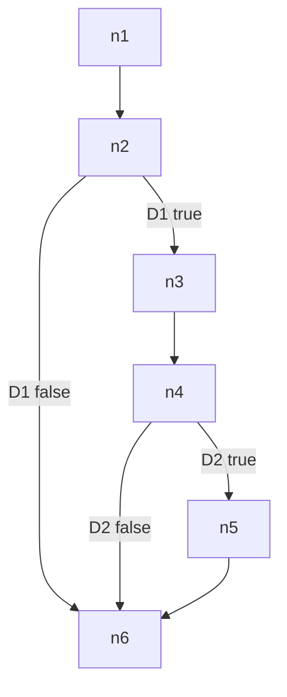
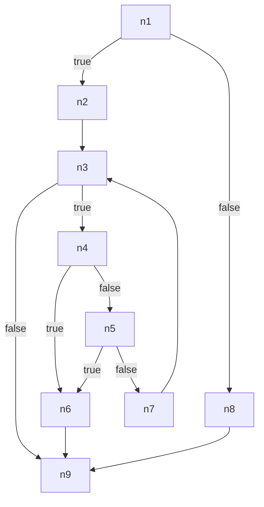

# Bonus: Basis Path Testing of `CashValidator` and `FormatChecker`

Owner: alessiap000
Test classes: `src/test/java/atm/utils/CashValidatorTest.java`, `src/test/java/atm/utils/FormatCheckerTest.java`

## Section 1: Process and assumptions

**Technique.** Basis path testing (McCabe). For each method we drew the control flow
graph from the source, computed the cyclomatic complexity V(G) = E - N + 2, and picked
V(G) linearly independent paths with the baseline method: take one normal path, then
flip one decision at a time. Each path gets at least one test. The paths come from the
code, but every expected value comes from the specification, never from the code.

**Oracle.** The A2 handout gives fee figures only for `FeesCalculator`, and it allows bonus
tests on faults outside that target. It gives no rules for withdrawal amounts or PINs, so the
expected values here come from the ATM system specification used in Assignment 1, which the
A2 handout does not change.

**Assumptions.**

1. **B-A1. Withdrawal amounts.** The ATM dispenses $20 and $50 bills, so an amount is valid only if some mix of the two makes it (same as S-A2 in A1).
2. **B-A2. PIN format.** A valid PIN is exactly 5 characters, each a digit 0-9 (same as S-A4 in A1).
3. **B-A3. Compound conditions.** Java's `||` short-circuits, so `(pin[i] < '0') || (pin[i] >= '9')` on line 35 of `FormatChecker` becomes two decision nodes. This matches JaCoCo, which also counts a complexity of 5 for `checkPinFormat`.
4. **B-A4. Unit level.** The methods are called directly, not through `ATM` or `Session`. They have no collaborators, so no mocks are needed.

## Section 2: `CashValidator.validateWithdrawal`

### 2.1 Control flow graph

| Node | Line(s) | Statement |
|---|---|---|
| n1 | 21-23 | `result = true; newAmount = amount % 50` |
| n2 | 24 | `if (!(newAmount == 0))` (D1) |
| n3 | 25 | `newAmount = newAmount % 20` |
| n4 | 26 | `if (!(newAmount == 0))` (D2) |
| n5 | 27 | `result = false` |
| n6 | 31 | `return result` |

V(G) = 7 edges - 6 nodes + 2 = **3** (2 decisions + 1).

### 2.2 Basis paths and test cases

| Path | Nodes | Condition on `amount` |
|---|---|---|
| P1 | n1, n2, n6 | `amount % 50 == 0` |
| P2 | n1, n2, n3, n4, n6 | `amount % 50 != 0` and `(amount % 50) % 20 == 0` |
| P3 | n1, n2, n3, n4, n5, n6 | `amount % 50 != 0` and `(amount % 50) % 20 != 0` |

P3 has two tests. The code returns false for every input on it, so one test uses an
amount the bills can make and one uses an amount they cannot.

| ID | Path | `amount` | Expected (spec) | Actual | Status |
|---|---|---|---|---|---|
| BON-01 | P1 | 100 (2 x $50) | true | true | Pass |
| BON-02 | P2 | 40 (2 x $20) | true | true | Pass |
| BON-03 | P3 | 60 (3 x $20) | true | false | **Fail** |
| BON-04 | P3 | 30 (no mix) | false | false | Pass |

## Section 3: `FormatChecker.checkPinFormat`

### 3.1 Control flow graph

| Node | Line | Statement |
|---|---|---|
| n1 | 33 | `if (pin.length == 4)` |
| n2 | 34 | `i = 0` |
| n3 | 34 | `i < 4` |
| n4 | 35 | `pin[i] < '0'` |
| n5 | 35 | `pin[i] >= '9'` |
| n6 | 36 | `throw new InvalidPinFormatException()` |
| n7 | 34 | `i++` |
| n8 | 40 | `throw new InvalidPinFormatException()` |
| n9 | - | exit |

V(G) = 12 edges - 9 nodes + 2 = **5** (4 conditions + 1).

### 3.2 Basis paths and test cases

| Path | Nodes | Decision flipped from B1 |
|---|---|---|
| B1 | n1, n2, (n3, n4, n5, n7) x 4, n3, n9 | baseline: 4 characters, all pass the loop |
| B2 | n1, n8, n9 | n1 (length is not 4) |
| B3 | n1, n2, n3, n4, n6, n9 | n4 (first character below `'0'`) |
| B4 | n1, n2, n3, n4, n5, n6, n9 | n5 (first character `'9'` or above) |
| B5 | n1, n2, n3, n4, n5, n7, n3, n4, n5, n6, n9 | n5 on the second iteration |

Flipping n3 on its first visit is infeasible: with length 4, `0 < 4` is always true. B5
is the fifth independent path. It is the only one that takes the back edge n7-n3 without
the exit edge n3-n9, so it is not a combination of B1 to B4.

| ID | Path | PIN | Expected (spec) | Actual | Status |
|---|---|---|---|---|---|
| BON-05 | B1 | `1234` | Rejected (4 digits) | Accepted | **Fail** |
| BON-06 | B2 | `12345` | Accepted | Rejected | **Fail** |
| BON-07 | B3 | `-123` | Rejected | Rejected | Pass |
| BON-08 | B4 | `9123` | Rejected (4 digits) | Rejected | Pass |
| BON-09 | B5 | `1a23` | Rejected | Rejected | Pass |

## Section 4: Results

Local run (`mvn -B -Dmaven.test.failure.ignore=true test`). Replace with the CI numbers once the PR runs.

| Test class | Run | Passed | Failed |
|---|---:|---:|---:|
| `CashValidatorTest` | 4 | 3 | 1 |
| `FormatCheckerTest` | 5 | 3 | 2 |

Coverage (JaCoCo): `validateWithdrawal` 4/4 branches, `checkPinFormat` 8/8 branches.

## Section 5: Fault localization

| Fault | Failing tests | Location | Explanation |
|---|---|---|---|
| BON-F1 | BON-05, BON-06 | `FormatChecker.checkPinFormat`, line 33: `if (pin.length == 4)` | The spec requires 5 digits. The length check uses 4, so a 4-digit PIN goes through the loop and is accepted (BON-05), and a 5-digit PIN goes straight to the `else` throw (BON-06). |
| BON-F2 | BON-03 | `CashValidator.validateWithdrawal`, lines 24-27: `amount % 50` then `% 20` | The method only accepts amounts that are some number of $50s plus a multiple of $20 less than $50 (`amount % 50` is 0, 20 or 40). It never tries fewer $50 bills, so mixes like $60 = 3 x $20 or $110 = $50 + 3 x $20 are rejected. |

**Masked fault.** Line 35 of `FormatChecker` uses `pin[i] >= '9'`, which also rejects the
valid digit 9 (it should be `> '9'`). BON-08 runs this condition with `'9'` but passes,
because the PIN has 4 characters and the spec rejects it anyway. Any input that reaches
line 35 has length 4 (BON-F1), so no test can expose this fault until BON-F1 is fixed.
