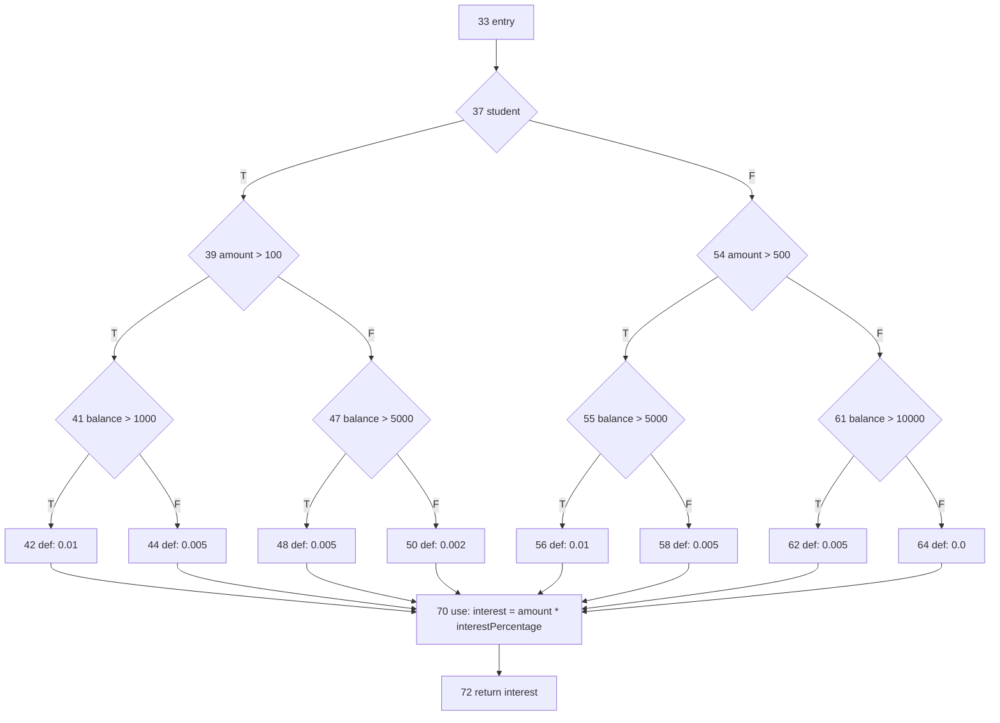

# Assignment 2: Deposit fees (DU-paths for `interestPercentage` + statement coverage)

Target: `bank.utils.FeesCalculator.calculateDepositInterest(double amount, double accountBalance, boolean student)`
Technique: data-flow testing. Compute every DU-path of `interestPercentage` to its use in `double interest = amount * interestPercentage`, then cover the statements of each DU-path
JUnit class: `src/test/java/bank/utils/FeesCalculatorDepositTest.java`

## Section 1: Process and assumptions

### Specification under test (oracle)

| Rule | Condition | Fee |
|---|---|---|
| S1 | Student, amount > $100, balance > $1,000 | 1% of amount |
| S2 | Student, amount > $100, balance <= $1,000 | 0.5% of amount |
| S3 | Student, amount <= $100, balance > $5,000 | 0.5% of amount |
| S4 | Student, amount <= $100, balance <= $5,000 | no fee |
| N1 | Not a student, amount > $500, balance > $5,000 | 1% of amount |
| N2 | Not a student, amount > $500, balance <= $5,000 | 0.5% of amount |
| N3 | Not a student, amount <= $500, balance > $10,000 | 0.5% of amount |
| N4 | Not a student, amount <= $500, balance <= $10,000 | no fee |

The expected value for every test case is `amount x rate`, with the rate taken from this table. The table is the oracle. The code is used only to pick which DU-path a test must execute, never to decide the expected value.

### Code under analysis

Line numbers are those of `src/main/java/bank/utils/FeesCalculator.java`.

```java
33	public double calculateDepositInterest(double amount, double accountBalance, boolean student) {
34		// Calculate interest percentage
35		double interestPercentage;
36		// Check if student
37		if (student) {
38			// Check amount deposited
39			if (amount > 100.00) {
40				// Check balance
41				if (accountBalance > 1000.00) {
42					interestPercentage = 0.01;
43				} else {
44					interestPercentage = 0.005;
45				}
46			} else {
47				if (accountBalance > 5000.00) {
48					interestPercentage = 0.005;
49				} else {
50					interestPercentage = 0.002;
51				}
52			}
53		} else {
54			if (amount > 500.00) {
55				if (accountBalance > 5000.00) {
56					interestPercentage = 0.01;
57				} else {
58					interestPercentage = 0.005;
59				}
60			} else {
61				if (accountBalance > 10000.00) {
62					interestPercentage = 0.005;
63				} else {
64					interestPercentage = 0.0;
65				}
66			}
67		}
68
69		// Calculate interest
70		double interest = amount * interestPercentage;
71
72		return interest;
73	}
```

### Control-flow graph

Nodes are numbered by line. Predicate nodes show their condition; the edge labels are the outcomes.



### Process

1. **Find the definitions.** A definition of `interestPercentage` is a statement that assigns it a value. There are eight: lines 42, 44, 48, 50, 56, 58, 62 and 64. Each is the only statement in a leaf branch of the nested `if` statements.
2. **Find the uses.** `interestPercentage` is read in one place only: line 70, `double interest = amount * interestPercentage;`. It is a computation use (c-use), because the value feeds a calculation, not a branch condition. None of the predicates (37, 39, 41, 47, 54, 55, 61) reads `interestPercentage`, so there are no predicate uses (p-uses).
3. **Pair each definition with the use.** For each definition `d`, a DU-path is a path from `d` to line 70 on which no other statement redefines `interestPercentage` (a definition-clear path). After any of the eight assignments, control leaves the `if` chain through closing braces only and reaches line 70 directly. No other assignment lies on that path, so every pair is definition-clear and has exactly one DU-path.
4. **Result.** 8 definitions x 1 use = 8 DU-paths, one per leaf branch.
5. **Turn each DU-path into a test.** A test must enter the method, take the predicate outcomes that lead to the definition, execute the definition, then the use and the return. The statements a test must execute for each DU-path are listed in the table below. Inputs are chosen to satisfy those predicate outcomes. The expected value comes from the specification rule that governs the same inputs.

### DU-path table

| DU-path | Definition (line: value assigned) | Use | DU-path (def to use) | Statements a test executes (with predicate outcomes) | Spec rule |
|---|---|---|---|---|---|
| DU1 | 42: `0.01` | 70 | <42, 70> | 33, 37 (T), 39 (T), 41 (T), 42, 70, 72 | S1: 1% |
| DU2 | 44: `0.005` | 70 | <44, 70> | 33, 37 (T), 39 (T), 41 (F), 44, 70, 72 | S2: 0.5% |
| DU3 | 48: `0.005` | 70 | <48, 70> | 33, 37 (T), 39 (F), 47 (T), 48, 70, 72 | S3: 0.5% |
| DU4 | 50: `0.002` | 70 | <50, 70> | 33, 37 (T), 39 (F), 47 (F), 50, 70, 72 | S4: no fee |
| DU5 | 56: `0.01` | 70 | <56, 70> | 33, 37 (F), 54 (T), 55 (T), 56, 70, 72 | N1: 1% |
| DU6 | 58: `0.005` | 70 | <58, 70> | 33, 37 (F), 54 (T), 55 (F), 58, 70, 72 | N2: 0.5% |
| DU7 | 62: `0.005` | 70 | <62, 70> | 33, 37 (F), 54 (F), 61 (T), 62, 70, 72 | N3: 0.5% |
| DU8 | 64: `0.0` | 70 | <64, 70> | 33, 37 (F), 54 (F), 61 (F), 64, 70, 72 | N4: no fee |

(T) / (F): the outcome of the predicate on that path. The "value assigned" column records what the code does on each path. It is not the oracle.

### Statements left out of the DU-path analysis

| Line(s) | Content | Why it is left out |
|---|---|---|
| 34, 36, 38, 40, 69 | comments | Not executable. |
| 35 | `double interestPercentage;` | A declaration with no initializer: it assigns no value, so it is not a definition (see D-A1). |
| 43, 45, 46, 49, 51 to 53, 57, 59, 60, 63, 65 to 67, 73 | `} else {`, closing braces | Syntax only; each branch is represented by its predicate. |
| 68, 71 | blank lines | Not executable. |

### Assumptions

1. **D-A1. Declarations without initializers are not definitions.** `double interestPercentage;` (line 35) assigns no value. Java's definite-assignment rule guarantees that one of the eight assignments always runs before line 70, so line 35 starts no DU-path.
2. **D-A2. No rounding in the code under test.** The original handout reads `int interest = Math.round(amount * interestPercentage)`. The code reads `double interest = amount * interestPercentage` with no rounding. As the handout's note directs, the DU-paths are computed from the code as it is. Expected values are compared unrounded, with the tolerance in D-A3.
3. **D-A3. Oracle tolerance.** The method returns a `double`, compared with a tolerance of 1e-6. The smallest difference between the expected value and any other rate's value in this suite is $0.10 (0.2% of $50), far above the tolerance, so a wrong rate cannot hide inside it.
4. **D-A4. "Interest" is the deposit fee.** The method is named `calculateDepositInterest` and the variable `interestPercentage`, but the specification describes a deposit fee. The returned value is treated as the fee: `amount x` the specification rate.
5. **D-A5. Strict thresholds.** "More than $X" means strictly greater than X, and "$X or less" means less than or equal to X, matching the specification's wording. DU-path coverage does not call for boundary values, so every test input sits well away from the thresholds ($100, $500, $1,000, $5,000, $10,000) and lands on its DU-path without doubt.
6. **D-A6. Amounts are positive and non-zero.** Every test deposits a positive amount, so a wrong rate always produces a visibly wrong result, including on the two "no fee" paths.
