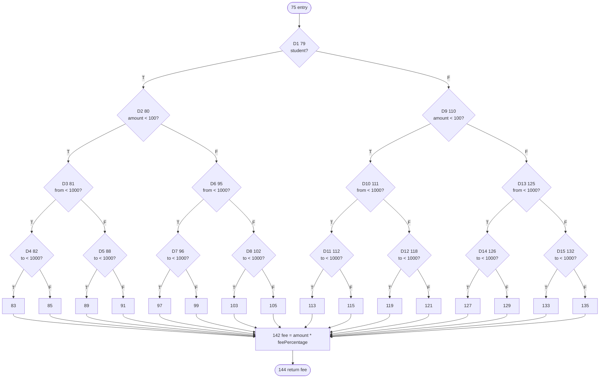

# Assignment 2: Transfer fees (basis path testing)

Target: `bank.utils.FeesCalculator.calculateTransferFee(double amount, double fromAccountBalance, double toAccountBalance, boolean student)`
Technique: basis path testing (McCabe): control-flow graph, cyclomatic complexity V(G), one test per basis path
JUnit class: `src/test/java/bank/utils/FeesCalculatorTransferTest.java`

## Section 1: Process and assumptions

### Specification under test (oracle)

From the A2 handout, transfer section. "From" is the balance of the account the money leaves; "to" is the balance of the account it goes to.

| Rule | Student | Amount | From balance | To balance | Fee |
|---|---|---|---|---|---|
| S1 | yes | < $100 | < $1,000 | < $1,000 | 0.1% of amount |
| S2 | yes | < $100 | < $1,000 | >= $1,000 | 0.05% of amount |
| S3 | yes | < $100 | >= $1,000 | < $1,000 | 0.5% of amount |
| S4 | yes | < $100 | >= $1,000 | >= $1,000 | 0.25% of amount |
| S5 | yes | >= $100 | < $1,000 | < $1,000 | 0.05% of amount |
| S6 | yes | >= $100 | < $1,000 | >= $1,000 | 0.025% of amount |
| S7 | yes | >= $100 | >= $1,000 | < $1,000 | 0.25% of amount |
| S8 | yes | >= $100 | >= $1,000 | >= $1,000 | 0.125% of amount |
| N1 | no | < $100 | < $1,000 | < $1,000 | 0.2% of amount |
| N2 | no | < $100 | < $1,000 | >= $1,000 | 0.1% of amount |
| N3 | no | < $100 | >= $1,000 | < $1,000 | 1% of amount |
| N4 | no | < $100 | >= $1,000 | >= $1,000 | 0.5% of amount |
| N5 | no | >= $100 | < $1,000 | < $1,000 | 0.1% of amount |
| N6 | no | >= $100 | < $1,000 | >= $1,000 | 0.05% of amount |
| N7 | no | >= $100 | >= $1,000 | < $1,000 | 0.5% of amount |
| N8 | no | >= $100 | >= $1,000 | >= $1,000 | 0.25% of amount |

The expected fee for every test case is `amount x rate` with the rate taken from this table. The table is the oracle; the code is used only to choose which path a test must run, never to decide the expected value. How the "Otherwise" lines of the handout map to S2, S4, S6, ... is explained in T-A1.

### Code under analysis

Line numbers are those of `src/main/java/bank/utils/FeesCalculator.java`.

```java
 75	public double calculateTransferFee(double amount, double fromAccountBalance, double toAccountBalance, boolean student) {
 76		// Calculate fee percentage
 77		double feePercentage;
 78		// Check if student
 79		if (student) {
 80			if (amount < 100.00) {
 81				if (fromAccountBalance < 1000.00) {
 82					if (toAccountBalance < 1000.00) {
 83						feePercentage = 0.01;
 84					} else {
 85						feePercentage = 0.005;
 86					}
 87				} else {
 88					if (toAccountBalance < 1000.00) {
 89						feePercentage = 0.05;
 90					} else {
 91						feePercentage = 0.025;
 92					}
 93				}
 94			} else {
 95				if (fromAccountBalance < 1000.00) {
 96					if (toAccountBalance < 1000.00) {
 97						feePercentage = 0.005;
 98					} else {
 99						feePercentage = 0.0025;
100					}
101				} else {
102					if (toAccountBalance < 1000.00) {
103						feePercentage = 0.025;
104					} else {
105						feePercentage = 0.0125;
106					}
107				}
108			}
109		} else {
110			if (amount < 100.00) {
111				if (fromAccountBalance < 1000.00) {
112					if (toAccountBalance < 1000.00) {
113						feePercentage = 0.02;
114					} else {
115						feePercentage = 0.01;
116					}
117				} else {
118					if (toAccountBalance < 1000.00) {
119						feePercentage = 0.1;
120					} else {
121						feePercentage = 0.05;
122					}
123				}
124			} else {
125				if (fromAccountBalance < 1000.00) {
126					if (toAccountBalance < 1000.00) {
127						feePercentage = 0.01;
128					} else {
129						feePercentage = 0.005;
130					}
131				} else {
132					if (toAccountBalance < 1000.00) {
133						feePercentage = 0.05;
134					} else {
135						feePercentage = 0.055;
136					}
137				}
138			}
139		}
140		
141		// Calculate fee
142		double fee = amount * feePercentage;
143		
144		return fee;
145	}
```

### Process

1. **Build the control-flow graph (CFG).** One node per decision (`if`), one node per assignment to `feePercentage`, plus the method entry, the fee calculation and the return. Nodes are named by their line number.
2. **Count V(G) three ways** and check that they agree.
3. **Pick the basis paths with the baseline method.** Start with one full path (the baseline), then make each new path by flipping exactly one decision of a path already chosen. Each new path must use at least one edge no earlier path used, which makes the set linearly independent.
4. **Pick inputs that force each path**, then take the expected fee from the specification table above.

### Control-flow graph

**Nodes (34).**

| Node | Line | Statement | Kind |
|---|---|---|---|
| 75 | 75, 77 | method entry (parameters), `double feePercentage;` | entry |
| D1 | 79 | `if (student)` | decision |
| D2 | 80 | `if (amount < 100.00)` (student side) | decision |
| D3 | 81 | `if (fromAccountBalance < 1000.00)` | decision |
| D4 | 82 | `if (toAccountBalance < 1000.00)` | decision |
| 83 | 83 | `feePercentage = 0.01;` | assignment |
| 85 | 85 | `feePercentage = 0.005;` | assignment |
| D5 | 88 | `if (toAccountBalance < 1000.00)` | decision |
| 89 | 89 | `feePercentage = 0.05;` | assignment |
| 91 | 91 | `feePercentage = 0.025;` | assignment |
| D6 | 95 | `if (fromAccountBalance < 1000.00)` | decision |
| D7 | 96 | `if (toAccountBalance < 1000.00)` | decision |
| 97 | 97 | `feePercentage = 0.005;` | assignment |
| 99 | 99 | `feePercentage = 0.0025;` | assignment |
| D8 | 102 | `if (toAccountBalance < 1000.00)` | decision |
| 103 | 103 | `feePercentage = 0.025;` | assignment |
| 105 | 105 | `feePercentage = 0.0125;` | assignment |
| D9 | 110 | `if (amount < 100.00)` (non-student side) | decision |
| D10 | 111 | `if (fromAccountBalance < 1000.00)` | decision |
| D11 | 112 | `if (toAccountBalance < 1000.00)` | decision |
| 113 | 113 | `feePercentage = 0.02;` | assignment |
| 115 | 115 | `feePercentage = 0.01;` | assignment |
| D12 | 118 | `if (toAccountBalance < 1000.00)` | decision |
| 119 | 119 | `feePercentage = 0.1;` | assignment |
| 121 | 121 | `feePercentage = 0.05;` | assignment |
| D13 | 125 | `if (fromAccountBalance < 1000.00)` | decision |
| D14 | 126 | `if (toAccountBalance < 1000.00)` | decision |
| 127 | 127 | `feePercentage = 0.01;` | assignment |
| 129 | 129 | `feePercentage = 0.005;` | assignment |
| D15 | 132 | `if (toAccountBalance < 1000.00)` | decision |
| 133 | 133 | `feePercentage = 0.05;` | assignment |
| 135 | 135 | `feePercentage = 0.055;` | assignment |
| 142 | 142 | `double fee = amount * feePercentage;` | join |
| 144 | 144 | `return fee;` | exit |

**Edges (48):** 1 from the entry to D1, 2 out of each of the 15 decisions (30), 1 from each of the 16 assignments to 142 (16), and 1 from 142 to 144.



### Cyclomatic complexity

| Method | Working | V(G) |
|---|---|---|
| Edges and nodes | E - N + 2 = 48 - 34 + 2 | **16** |
| Decisions | P + 1 = 15 + 1 | **16** |
| Regions | 15 bounded regions, one between each pair of neighbouring paths into node 142, plus the outer region | **16** |

All three agree, so the basis set has **16 paths**.

### Basis paths

P1 is the baseline (every decision true). Each later path flips one decision of an earlier path, shown in "Built from". "New edges" lists the edges that path is the first to use; since every path adds at least one new edge, the 16 paths are linearly independent, and together they use all 48 edges.

| Path | Decisions taken | Nodes | Built from | New edges |
|---|---|---|---|---|
| P1 | D1 T, D2 T, D3 T, D4 T | 75, D1, D2, D3, D4, 83, 142, 144 | baseline | 75-D1, D1-D2, D2-D3, D3-D4, D4-83, 83-142, 142-144 |
| P2 | D1 T, D2 T, D3 T, D4 F | 75, D1, D2, D3, D4, 85, 142, 144 | P1, flip D4 | D4-85, 85-142 |
| P3 | D1 T, D2 T, D3 F, D5 T | 75, D1, D2, D3, D5, 89, 142, 144 | P1, flip D3 | D3-D5, D5-89, 89-142 |
| P4 | D1 T, D2 T, D3 F, D5 F | 75, D1, D2, D3, D5, 91, 142, 144 | P3, flip D5 | D5-91, 91-142 |
| P5 | D1 T, D2 F, D6 T, D7 T | 75, D1, D2, D6, D7, 97, 142, 144 | P1, flip D2 | D2-D6, D6-D7, D7-97, 97-142 |
| P6 | D1 T, D2 F, D6 T, D7 F | 75, D1, D2, D6, D7, 99, 142, 144 | P5, flip D7 | D7-99, 99-142 |
| P7 | D1 T, D2 F, D6 F, D8 T | 75, D1, D2, D6, D8, 103, 142, 144 | P5, flip D6 | D6-D8, D8-103, 103-142 |
| P8 | D1 T, D2 F, D6 F, D8 F | 75, D1, D2, D6, D8, 105, 142, 144 | P7, flip D8 | D8-105, 105-142 |
| P9 | D1 F, D9 T, D10 T, D11 T | 75, D1, D9, D10, D11, 113, 142, 144 | P1, flip D1 | D1-D9, D9-D10, D10-D11, D11-113, 113-142 |
| P10 | D1 F, D9 T, D10 T, D11 F | 75, D1, D9, D10, D11, 115, 142, 144 | P9, flip D11 | D11-115, 115-142 |
| P11 | D1 F, D9 T, D10 F, D12 T | 75, D1, D9, D10, D12, 119, 142, 144 | P9, flip D10 | D10-D12, D12-119, 119-142 |
| P12 | D1 F, D9 T, D10 F, D12 F | 75, D1, D9, D10, D12, 121, 142, 144 | P11, flip D12 | D12-121, 121-142 |
| P13 | D1 F, D9 F, D13 T, D14 T | 75, D1, D9, D13, D14, 127, 142, 144 | P9, flip D9 | D9-D13, D13-D14, D14-127, 127-142 |
| P14 | D1 F, D9 F, D13 T, D14 F | 75, D1, D9, D13, D14, 129, 142, 144 | P13, flip D14 | D14-129, 129-142 |
| P15 | D1 F, D9 F, D13 F, D15 T | 75, D1, D9, D13, D15, 133, 142, 144 | P13, flip D13 | D13-D15, D15-133, 133-142 |
| P16 | D1 F, D9 F, D13 F, D15 F | 75, D1, D9, D13, D15, 135, 142, 144 | P15, flip D15 | D15-135, 135-142 |

Edge count check: 7 + 2 + 3 + 2 + 4 + 2 + 3 + 2 + 5 + 2 + 3 + 2 + 4 + 2 + 3 + 2 = 48.

The method has no loops and every decision is a separate `if`, so the CFG is a tree of decisions that joins again at line 142. It has exactly 16 entry-to-exit paths, the same as V(G): here the basis set is every path through the method, and each one ends at a different assignment to `feePercentage`.

### Assumptions

1. **T-A1. Reading "Otherwise" in the handout.** For each group (student or not, amount below or at least $100), the handout first gives the case where the from balance is under $1,000 and the to balance is under $1,000, then says "Otherwise". It then gives the case where the from balance is $1,000 or more and the to balance is under $1,000, then says "Otherwise" again. We read each "Otherwise" as "same from-balance case, but the to balance is $1,000 or more". So the first "Otherwise" is from < $1,000 and to >= $1,000 (S2, S6, N2, N6), and the second is from >= $1,000 and to >= $1,000 (S4, S8, N4, N8). This gives four cases per group with no overlap and no gap.
2. **T-A2. Each decision is one simple condition.** None of the 15 `if`s uses `&&` or `||`, so no decision has to be split into several nodes, and P = 15.
3. **T-A3. Declarations and comments are not nodes.** `double feePercentage;` (line 77) gives no value, so it is merged into the entry node. Comments, `else` and closing braces are not executable.
4. **T-A4. Every path is feasible.** The four decisions on any path test four different inputs (`student`, `amount`, `fromAccountBalance`, `toAccountBalance`), and none of these change inside the method. So any T/F combination can be forced by picking the inputs, and all 16 paths are feasible.
5. **T-A5. Input values.** Each decision is steered with a value well inside its range: amount $50.00 (< $100) or $500.00 (>= $100); balances $500.00 (< $1,000) or $5,000.00 (>= $1,000). Basis path testing asks for one test per path, not for boundary values, and keeping away from $100 and $1,000 means a failing test points at the fee on its path and not at an edge case. (Boundaries were covered in Assignment 1.)
6. **T-A6. No rounding.** `calculateTransferFee` returns `amount * feePercentage` with no rounding call. Expected fees are compared unrounded with a tolerance of 1e-6, far smaller than one cent, so a wrong rate cannot hide inside the tolerance.

## Section 2: Test cases

Coverage criterion: one test per basis path, so every path P1 to P16 is executed (and with it every node and every edge of the CFG).

| ID | Path | Student | Amount | From balance | To balance | Spec rule | Expected fee |
|---|---|---|---|---|---|---|---|
| TF-01 | P1 | yes | $50.00 | $500.00 | $500.00 | S1: 0.1% x 50 | 0.05 |
| TF-02 | P2 | yes | $50.00 | $500.00 | $5,000.00 | S2: 0.05% x 50 | 0.025 |
| TF-03 | P3 | yes | $50.00 | $5,000.00 | $500.00 | S3: 0.5% x 50 | 0.25 |
| TF-04 | P4 | yes | $50.00 | $5,000.00 | $5,000.00 | S4: 0.25% x 50 | 0.125 |
| TF-05 | P5 | yes | $500.00 | $500.00 | $500.00 | S5: 0.05% x 500 | 0.25 |
| TF-06 | P6 | yes | $500.00 | $500.00 | $5,000.00 | S6: 0.025% x 500 | 0.125 |
| TF-07 | P7 | yes | $500.00 | $5,000.00 | $500.00 | S7: 0.25% x 500 | 1.25 |
| TF-08 | P8 | yes | $500.00 | $5,000.00 | $5,000.00 | S8: 0.125% x 500 | 0.625 |
| TF-09 | P9 | no | $50.00 | $500.00 | $500.00 | N1: 0.2% x 50 | 0.10 |
| TF-10 | P10 | no | $50.00 | $500.00 | $5,000.00 | N2: 0.1% x 50 | 0.05 |
| TF-11 | P11 | no | $50.00 | $5,000.00 | $500.00 | N3: 1% x 50 | 0.50 |
| TF-12 | P12 | no | $50.00 | $5,000.00 | $5,000.00 | N4: 0.5% x 50 | 0.25 |
| TF-13 | P13 | no | $500.00 | $500.00 | $500.00 | N5: 0.1% x 500 | 0.50 |
| TF-14 | P14 | no | $500.00 | $500.00 | $5,000.00 | N6: 0.05% x 500 | 0.25 |
| TF-15 | P15 | no | $500.00 | $5,000.00 | $500.00 | N7: 0.5% x 500 | 2.50 |
| TF-16 | P16 | no | $500.00 | $5,000.00 | $5,000.00 | N8: 0.25% x 500 | 1.25 |

## Test results

Local run (`mvn -B -Dmaven.test.failure.ignore=true test`): 16 run, 0 passed, 16 failed. Checkstyle: 0 violations. Replace with the CI numbers from this PR once it runs.

| ID | Path | Expected fee (spec) | Actual fee | Result |
|---|---|---|---|---|
| TF-01 | P1 | 0.05 | 0.50 | **Fail** |
| TF-02 | P2 | 0.025 | 0.25 | **Fail** |
| TF-03 | P3 | 0.25 | 2.50 | **Fail** |
| TF-04 | P4 | 0.125 | 1.25 | **Fail** |
| TF-05 | P5 | 0.25 | 2.50 | **Fail** |
| TF-06 | P6 | 0.125 | 1.25 | **Fail** |
| TF-07 | P7 | 1.25 | 12.50 | **Fail** |
| TF-08 | P8 | 0.625 | 6.25 | **Fail** |
| TF-09 | P9 | 0.10 | 1.00 | **Fail** |
| TF-10 | P10 | 0.05 | 0.50 | **Fail** |
| TF-11 | P11 | 0.50 | 5.00 | **Fail** |
| TF-12 | P12 | 0.25 | 2.50 | **Fail** |
| TF-13 | P13 | 0.50 | 5.00 | **Fail** |
| TF-14 | P14 | 0.25 | 2.50 | **Fail** |
| TF-15 | P15 | 2.50 | 25.00 | **Fail** |
| TF-16 | P16 | 1.25 | 27.50 | **Fail** |

Every basis path returns the wrong fee. On P1 to P15 the actual fee is exactly 10 times the expected fee; on P16 it is 22 times.

## Fault localization

Each basis path ends at its own assignment to `feePercentage`, and the only other statement on the path is `fee = amount * feePercentage` (line 142), which every path shares. A path that fails while the shared statements are the same for all paths points at the one statement only that path runs: its `feePercentage` assignment.

| Fault | Failing tests | Location | Explanation |
|---|---|---|---|
| TF-F1 | TF-01 to TF-15 | `FeesCalculator.calculateTransferFee`, the `feePercentage` assignments on lines 83, 85, 89, 91, 97, 99, 103, 105, 113, 115, 119, 121, 127, 129, 133 | Each line sets a rate 10 times the A2 figure (for example line 83 sets `0.01` where S1 says 0.1% = `0.001`), so every one of these paths returns exactly 10 times the specified fee: the decimal point is one place off in every rate. |
| TF-F2 | TF-16 | `FeesCalculator.calculateTransferFee`, line 135: `feePercentage = 0.055;` | N8 says 0.25% = `0.0025`, but line 135 sets `0.055`, 22 times too high, so P16 returns $27.50 instead of $1.25. It is not the same 10x slip as TF-F1 (that would give `0.025`), so moving the decimal point alone would not fix it. |

Line 142 is not at fault: it runs on all 16 paths, and on each one the fee equals the amount times the rate set on that path, so the multiplication is right and only the rates are wrong.

Rates per path, for reference:

| Path | Line | Spec rate | Rate in code |
|---|---|---|---|
| P1 | 83 | 0.001 | 0.01 |
| P2 | 85 | 0.0005 | 0.005 |
| P3 | 89 | 0.005 | 0.05 |
| P4 | 91 | 0.0025 | 0.025 |
| P5 | 97 | 0.0005 | 0.005 |
| P6 | 99 | 0.00025 | 0.0025 |
| P7 | 103 | 0.0025 | 0.025 |
| P8 | 105 | 0.00125 | 0.0125 |
| P9 | 113 | 0.002 | 0.02 |
| P10 | 115 | 0.001 | 0.01 |
| P11 | 119 | 0.01 | 0.1 |
| P12 | 121 | 0.005 | 0.05 |
| P13 | 127 | 0.001 | 0.01 |
| P14 | 129 | 0.0005 | 0.005 |
| P15 | 133 | 0.005 | 0.05 |
| P16 | 135 | 0.0025 | 0.055 |

## Failure log (keep for Assignment 3)

TF-F1 and TF-F2 are logged in the team's combined log, `docs/assignment2/failure-log.md`.
